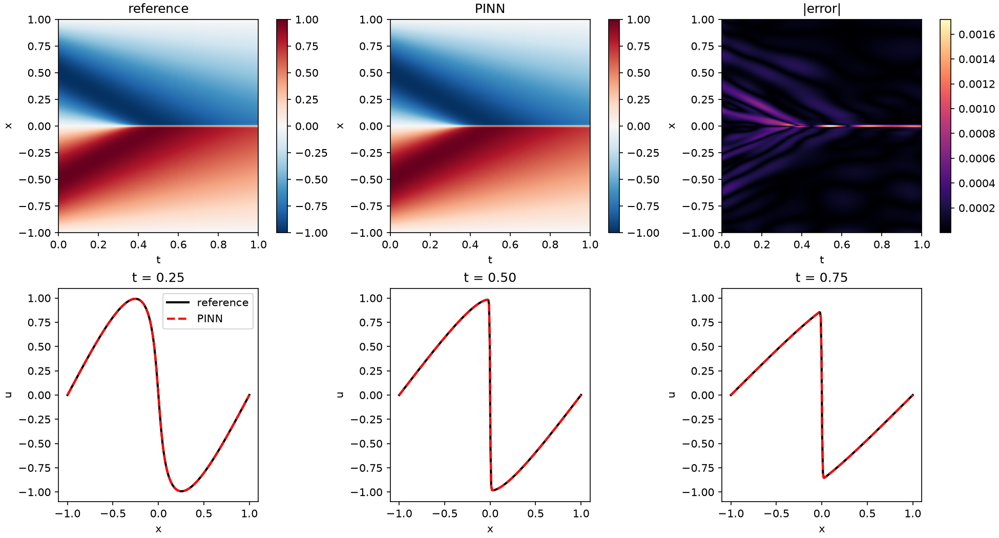
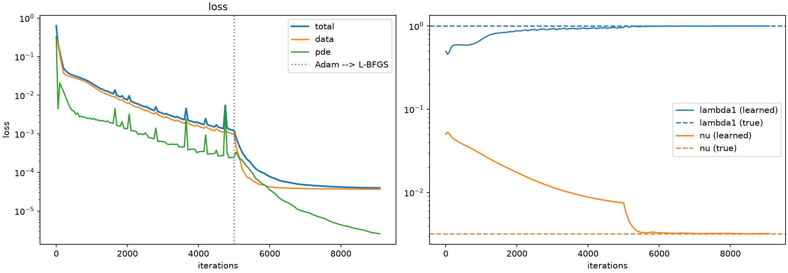
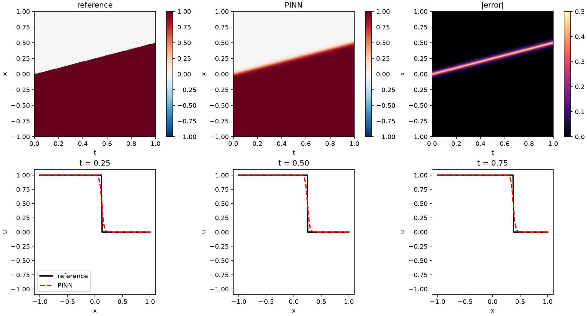
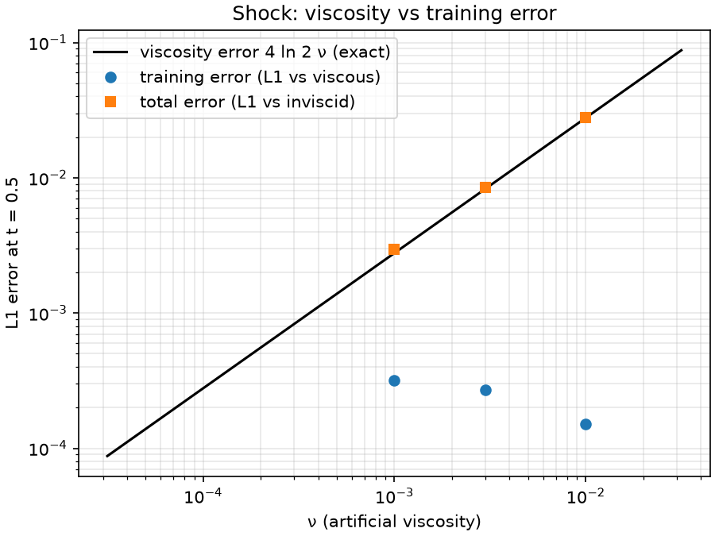

# pinnlab: physics-informed neural networks for fluid mechanics, evaluated like a numerical method

pinnlab is a study of physics-informed neural networks (PINNs) in Python (PyTorch, NumPy) for the partial
differential equations (PDEs) of computational fluid dynamics (CFD), starting with Burgers' equation. 
PINNs are evaluated the way one would evaluate any new numerical method: 
checked against exact solutions and published benchmarks, with their
error and cost measured, and with attention to where they struggle.

> **Status:** Phase 1 (viscous Burgers' equation, forward and inverse problems) is complete. A pilot study of
> Phase 2 (inviscid Burgers: Riemann problems with shocks and rarefactions) is done; the 1-D Euler equations
> (Sod shock tube) come next.

## Highlights

- **Verified reference solution:** the exact Cole–Hopf solution reproduces the benchmark of Basdevant et al. (1986),
  $\max_t |u_x(0, t)| = 152.00516$, to all 8 published digits.
- **Forward problem:** relative $L_2$ error **2.5e-4** in float64 (2.2e-3 in float32), below the 6.7e-4 reported by
  Raissi et al. (2019) for this benchmark problem.
- **Inverse problem:** from 2,000 measurements with 1% noise, starting from guesses 2× ($\lambda_1$) and 16× ($\nu$)
  off, the PINN recovers $\lambda_1$ to **0.08%** and $\nu$ to **1.0%**; the data misfit settles at the noise level.
- **Shocks (pilot):** with artificial viscosity, the PINN reproduces the Rankine–Hugoniot shock speed (0.4993 vs 0.5)
  and the viscous shock width. Its position error came entirely from the discontinuous initial condition (diagnosed
  through mass conservation); regularizing the initial step removes it, after which the error is the theoretical
  viscosity error $4\ln 2\,\nu$. For a rarefaction the PINN selects the entropy-correct fan.
- **Tested:** 16 pytest tests, including a manufactured solution for the PDE residual, the Basdevant benchmark, and
  exact Riemann solutions (shock speed, rarefaction fan, viscous shock profile).

## Problem

We study the viscous Burgers' equation

$$u_t + \lambda_1\ u\ u_x = \nu\ u_{xx}, \qquad x \in [-1, 1],\ t \in [0, 1],$$

with $\nu = 0.01/\pi$, initial condition $u(x, 0) = -\sin(\pi x)$ and boundary conditions $u(\pm 1, t) = 0$.
A shock forms at $x = 0$ around $t \approx 0.4$, where the gradient reaches $|u_x| \approx 152$: the kind of sharp
feature where PINNs typically struggle.

- **Forward problem:** $\lambda_1 = 1$ and $\nu = 0.01/\pi$ are known; find $u$. The loss penalizes the PDE residual at
  10,000 random collocation points, the initial condition (256 points) and the boundary conditions (2 × 200 points).
- **Inverse problem:** $\lambda_1$ and $\nu$ are unknown; find them and $u$ from 2,000 noisy measurements of $u$.
  The loss is data misfit + PDE residual; $\lambda_1$ and $\log\nu$ are trained together with the network
  ($\log\nu$ keeps $\nu$ positive and gives the optimizer steps of a relative size).

Setup for all runs: fully connected network, 8 hidden layers × 20 tanh units, inputs scaled to $[-1, 1]$;
5,000 Adam iterations (learning rate $10^{-3}$), then L-BFGS with a strong-Wolfe line search.

## Verification

The reference solution is the ruler for every PINN error reported here, so it is verified before any error is trusted.
It uses the Cole–Hopf transform, which turns Burgers' equation into the heat equation, whose solution is a Gaussian
convolution. After the substitution $\eta = \sqrt{4\nu t}\, z$ the integrals are evaluated with the trapezoidal rule,
which converges spectrally for this smooth, rapidly decaying integrand; log-sum-exp scaling prevents overflow.
The full 256 × 101 evaluation grid takes well under a second (vectorized NumPy).

Independent checks, all in `tests/test_burgers.py`:

- **Published benchmark:** $\max_t |u_x(0, t)| = 152.00516$ at $t \approx 0.51$ (Basdevant et al., 1986), reproduced
  to all 8 digits.
- **Initial condition:** exact at $t = 0$, and also reached through the integral formula at $t = 10^{-6}$.
- **Symmetry and boundaries:** $u(-x, t) = -u(x, t)$ and $u(\pm 1, t) = 0$ to $10^{-12}$.
- **PDE residual (autograd):** checked against hand-derived derivatives of the manufactured solution
  $u = \sin(\pi x)\, e^{-t}$, with deliberately unusual $\lambda_1 = 1.3$, $\nu = 0.07$ so that a wrong coefficient
  cannot hide.
- **Losses and training:** losses are finite and deterministic, every loss term sends gradients to every weight
  (and to $\lambda_1$, $\log\nu$), and training reduces the loss.

## Results

| Run | Relative $L_2$ error of $u$ | Learned coefficients | Training time |
|---|---|---|---|
| Forward, float32 | 2.2e-3 | — | 13 min |
| Forward, float64 | **2.5e-4** | — | 20 min |
| Inverse, float32 (2,000 points, 1% noise) | 1.2e-3 | $\lambda_1 = 1.0008$ (error 0.08%), $\nu = 3.215 \times 10^{-3}$ (error 1.0%) | 6 min |

Relative $L_2$ error over the 256 × 101 reference grid. Times on a 15 W laptop CPU (Intel Core Ultra 7 155U),
2 threads per run; the two forward runs ran at the same time. Each number comes from a single training run, so expect
some variation with the random seed. Raissi et al. (2019) used a slightly different network and number of
initial/boundary points, so the comparison with their 6.7e-4 is indicative rather than exact.



**Forward problem (float64).** The PINN matches the reference everywhere, including the shock. The remaining error is
concentrated on a thin band along the shock ($x = 0$, $t \gtrsim 0.4$): the steepest gradients are where the PDE
residual is hardest to satisfy, and the PDE term dominates the final loss.



**Inverse problem.** During Adam, $\nu$ decreases steadily in log space; after the switch to L-BFGS it reaches the true
value within about 500 evaluations. The data misfit levels off at $3.70 \times 10^{-5}$, matching the noise variance
$(0.01\,\mathrm{std}(u))^2 = 3.75 \times 10^{-5}$: the network fits the true solution and not the noise, while the PDE
residual keeps decreasing. $\nu$ is harder to identify than $\lambda_1$ because it multiplies $u_{xx}$, which is
significant only inside the thin shock, whereas $u\,u_x$ (the $\lambda_1$ term) is large almost everywhere.

## Phase 2a: shocks and rarefactions (pilot study)

Inviscid Burgers' equation $u_t + u\,u_x = 0$ on $x \in [-1, 1]$, $t \in [0, 1]$ with a step initial condition
($u_L$ for $x < 0$, $u_R$ for $x > 0$): a **shock** for $u_L = 1, u_R = 0$ (speed $s = (u_L + u_R)/2 = 0.5$) and a
**rarefaction** for $u_L = 0, u_R = 1$. A strong-form residual is undefined at a true discontinuity and a tanh network
is smooth, so the PINN solves $u_t + u\,u_x = \nu\,u_{xx}$ with a small **artificial viscosity** $\nu$, like a
shock-capturing scheme. Boundary values $u(-1, t) = u_L$, $u(1, t) = u_R$ (the waves stay inside the domain).

**References** (`src/pinnlab/problems/riemann.py`, tested in `tests/test_riemann.py`): the exact inviscid entropy
solution, and the exact viscous shock profile
$u = \tfrac{u_L + u_R}{2} - \tfrac{u_L - u_R}{2}\tanh\big(\tfrac{(u_L - u_R)(x - s t)}{4\nu}\big)$ (written with tanh so
it cannot overflow). They split the PINN error into a **viscosity error** (viscous vs inviscid, exactly
$\int |u_\nu - u_0|\,dx = 4\ln 2\,\nu$ for the shock) and a **training error** (PINN vs viscous). Errors are measured in
$L_1$, the natural norm for discontinuous solutions, together with shock-specific metrics: position (midpoint crossing,
linearly interpolated) and 10–90% thickness.

**1. The position error came from the initial condition, not the dynamics.** With the step initial condition
($\nu = 10^{-2}$), the PINN shock moved at speed 0.4993 (Rankine–Hugoniot: 0.5) with the correct viscous width, but
sat a constant ~0.012 behind its exact position; with different initial-condition settings the offset flipped to
+0.016. Measuring the **mass error** $\int (u_{\rm PINN} - u_{\rm exact})\,dx$ over time showed why: it was already
present at $t = 0$, equal to the offset, and constant afterwards. A smooth network cannot represent the step, and the
center of its smoothed step is only weakly determined by the initial-condition loss. Regularizing the initial step at
the viscous scale (a tanh profile with the exact mass) removed the offset, lowered the final loss from $6.3 \times
10^{-5}$ to $2.3 \times 10^{-7}$, and cut the training error 70×.



**2. Viscosity vs training error.** With the regularized initial condition and a fixed budget (20×4 network,
$10^4$ collocation points, 2,000 Adam + 2,000 L-BFGS iterations, about 1 min per run):

| $\nu$ | viscosity error $4\ln 2\,\nu$ | training error ($L_1$ vs viscous) | total ($L_1$ vs inviscid) | position offset | thickness / theory |
|---|---|---|---|---|---|
| $10^{-2}$ | 0.0277 | 1.5e-4 | 0.0277 | −3e-5 | 0.999 |
| $3 \times 10^{-3}$ | 0.0083 | 2.7e-4 | 0.0085 | 1e-4 | 0.999 |
| $10^{-3}$ | 0.0028 | 3.2e-4 | 0.0030 | 1e-4 | 0.998 |



The total error follows the viscosity error (slope 1 in ν); the training error grows slowly as the shock steepens
(roughly $\nu^{-1/3}$). Extrapolating, the two would cross near $\nu \approx 2 \times 10^{-4}$ for this budget (dotted
line), below which lowering ν would stop helping. This is a 3-point, single-seed estimate.

**3. Rarefaction: the entropy solution, and a larger viscosity cost.** For $u_L < u_R$ an unphysical expansion shock is
also a weak solution; only viscosity (vanishing-viscosity limit) selects the fan. The PINN's steepest slope relative
to the fan's ($1/t$) was 0.77 ($\nu = 10^{-2}$) and 0.97 ($\nu = 10^{-3}$), versus ≈ 11 and ≈ 110 for a smoothed
expansion shock: **it selects the fan**. Its $L_1$ error at $t = 0.5$ (0.058 and 0.0099) is close to that of the exact
viscous solution (0.051 and 0.0092, via Cole–Hopf), so the training error is again small, but larger than for the
shock at the same ν: shocks self-sharpen to a width ~ν, while the fan's corners diffuse over ~$\sqrt{\nu t}$.

## Performance notes

- **Threads.** For this small network, 2 CPU threads per run were fastest (38 ms per iteration); 14 threads were
  **55× slower** (2.4 s). Each layer is a tiny matrix product, so thread overhead and synchronization outweigh the
  extra cores, made worse by the hybrid performance/efficiency cores of a laptop CPU. Small problems are better served
  by running several jobs side by side (`scripts/bench_threads.py`).
- **Precision.** float64 was 8.6× more accurate than float32 for 1.45× the training time; float32 stops improving once
  the loss changes fall below its ~7 significant digits.

## How to run

CPU only; tested with Python 3.12 and PyTorch 2.14 on Ubuntu (WSL).

```bash
python3 -m venv .venv && source .venv/bin/activate
pip install torch --index-url https://download.pytorch.org/whl/cpu
pip install -e ".[dev]"

pytest -q                                                               # 16 verification and smoke tests
python -u scripts/run_burgers.py configs/burgers_forward.yaml --quick   # ~15 s pipeline check
python -u scripts/run_burgers.py configs/burgers_forward_f64.yaml       # forward problem, float64
python -u scripts/run_burgers.py configs/burgers_inverse.yaml           # inverse problem
```

Each run writes `results/<name>/` with `config.yaml` (the exact settings used), `metrics.json`, `history.json`,
`model.pt`, `solution.png` and `loss.png`. Options: `--threads N` (default 2), `--out DIR`.

## Repository layout

```
src/pinnlab/
  models.py            fully connected network with input scaling
  train.py             Adam → L-BFGS training loop with logging
  plotting.py          solution / error maps and loss curves
  utils.py             autograd helper, relative L2 error
  problems/burgers.py  PDE residual, exact Cole–Hopf solution, forward and inverse losses
  problems/riemann.py  exact Riemann solutions (inviscid, viscous shock), shock metrics, Riemann-problem loss
scripts/
  run_burgers.py       config-driven experiment runner
  bench_threads.py     CPU thread-count benchmark
  pilot/               Phase 2a pilot: viscosity sweep, trade-off plot, rarefaction runs
configs/               one YAML file per experiment
tests/                 verification and smoke tests
docs/figures/          figures used in this README
```

## Roadmap

| Phase | Problem | Question |
|---|---|---|
| 1 ✅ | Viscous Burgers' equation, forward and inverse | Can a PINN capture a steep shock, and recover PDE coefficients from noisy data? |
| 2 (pilot ✅) | Inviscid Burgers, Riemann problems | How well does a PINN with artificial viscosity capture true discontinuities, compared with exact solutions and implicit shock tracking? |
| 3 | 1-D Euler equations, Sod shock tube | Strong-form vs conservative/weak PINN formulations for a system with shock, contact and rarefaction. |
| 4 | Inverse shock problems | Recover a shock's location or speed from sparse noisy data: where PINNs may add value. |

## References

- M. Raissi, P. Perdikaris, G. E. Karniadakis, *Physics-informed neural networks: A deep learning framework for solving
  forward and inverse problems involving nonlinear partial differential equations*, J. Comput. Phys. 378 (2019).
- C. Basdevant, M. Deville, P. Haldenwang, J. M. Lacroix, J. Ouazzani, R. Peyret, P. Orlandi, A. T. Patera,
  *Spectral and finite difference solutions of the Burgers equation*, Computers & Fluids 14 (1986).
- E. Hopf, *The partial differential equation u_t + u u_x = μ u_xx*, Comm. Pure Appl. Math. 3 (1950);
  J. D. Cole, *On a quasi-linear parabolic equation occurring in aerodynamics*, Quart. Appl. Math. 9 (1951).
- L. N. Trefethen, J. A. C. Weideman, *The exponentially convergent trapezoidal rule*, SIAM Review 56 (2014).
- D. P. Kingma, J. Ba, *Adam: A method for stochastic optimization*, ICLR (2015).
